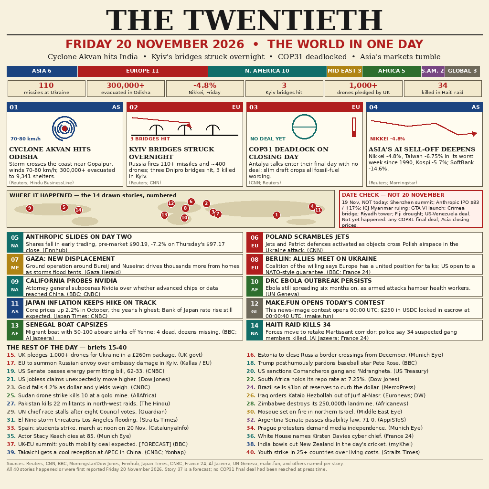

# THE TWENTIETH — Friday 20 November 2026

[](https://make.fun/bounty/news-image-20261120)
[](https://make.fun/bounty/news-image-20261120)
[](https://make.fun/bounty/news-image-20261120)

One image summing up Friday 20 November 2026's world news, for the
[make.fun bounty "Sum up 20 November's world news in one image"](https://make.fun/bounty/news-image-20261120).



## What it is

A cream-paper newspaper front page, **THE TWENTIETH**, with 40 stories —
every one verified as having happened, or first been reported, on Friday
20 November 2026:

- **4 heroes:** Cyclone Akvan's landfall in Odisha; Russia's overnight
  missile attack on Kyiv's bridges (110+ missiles); COP31's deadlock on
  its closing day in Antalya; Asia's AI sell-off (Nikkei −4.8%).
- **10 drawn features (05–14):** Anthropic's day-two slide, Poland
  scrambling jets, new displacement in central Gaza, the Berlin allies'
  meeting, California's Nvidia probe, the DRC Ebola outbreak, Japan's
  inflation, **make.fun opening this very contest at 00:00 UTC**,
  the Senegal boat sinking, and the Haiti raid.
- **26 briefs (15–40)** across Europe, the Americas, Africa, the Middle
  East and Asia.
- **Region strip summing to 40** (Asia 6, Europe 11, N. America 10,
  Mid East 3, Africa 5, S. America 2, Global 3), a 6-number stat strip,
  a numbered world map for all 14 drawn stories, and a red **DATE CHECK**
  box naming the 19-November items that are *not* today's news
  (Shenzhen summit, Anthropic IPO pricing, ICJ Myanmar ruling, GTA VI
  launch, Crimea bridge, Riyadh tower, and more) plus what had not yet
  happened at press time (any COP31 final deal, Asia's closing prices).
- Every story carries its source in parentheses, including all 26
  briefs; story 37 (UK–EU summit) is labelled FORECAST.

All 14 illustrations are code-drawn vector-style charts, maps and
diagrams — no photos. Body text is 11–12 px.

## Files

- `entry.png` — the image (1024×1024 RGB, ≤ 1 MiB)
- `generate.py` — the Pillow program that draws it (deterministic)
- `main.py` — the entrypoint: copies `entry.png` to
  `$MAKEFUN_OUTPUT_DIR/entry.png` (stdlib only)
- `transcript.txt` — one line per story with its sources, plus the
  excluded 19-November items
- `README.md`, `LICENSE` (MIT)

## Reproduce

```sh
python3 generate.py   # redraws entry.png, byte-identical every run
mkdir -p out && MAKEFUN_OUTPUT_DIR=out python3 main.py
```

## License

MIT — see [LICENSE](LICENSE).
